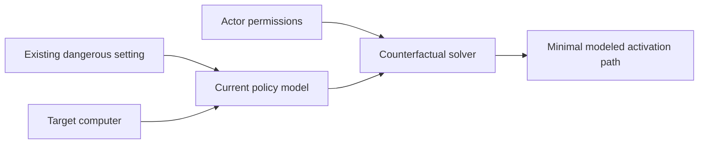
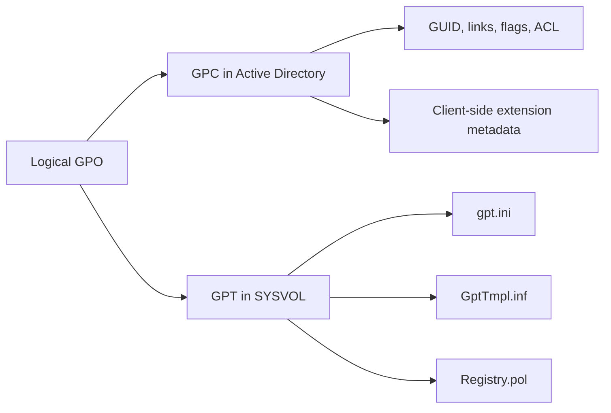
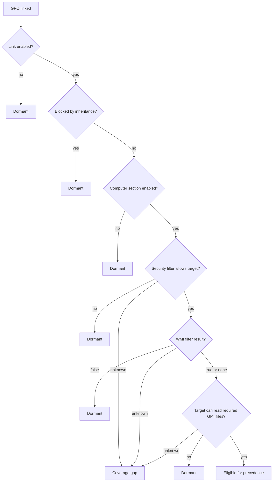
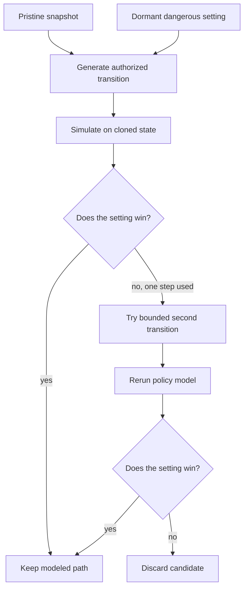
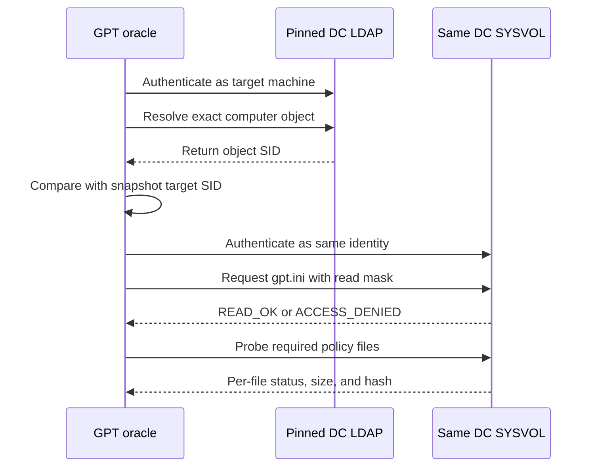

Most Group Policy tools show which GPOs apply, which ones an account can edit, or which ones contain risky settings. GPOWake asks a narrower question: does a dangerous setting already exist, and can a principal make it effective with one or two changes allowed by its current permissions?

GPOWake is read-only. It does not modify Active Directory or SYSVOL. It collects the state needed to model computer-side policy, identifies dangerous settings that currently lose or do not apply, and simulates candidate changes in memory.

A finding is more specific than “this account can write `gPLink`” or “this GPO contains `SeDebugPrivilege`.” It should identify the dormant setting, why it does not currently win, the actor’s effective right, and the smallest modeled transition that makes it win for a target.



## GPO state and the target policy path

A Group Policy Object has two parts. Its Group Policy Container (GPC) lives in Active Directory. Its Group Policy Template (GPT) lives in SYSVOL.



A GPO is linked to a Scope of Management (SOM), such as a site, domain, or OU. The target computer's path through those scopes determines which links can affect it. GPOWake reconstructs that path before evaluating settings.

The usual processing order is Local, Site, Domain, then parent and child OUs, often shortened to LSDOU. Later applicable policy can overwrite earlier policy for a single-value setting.

The `gPLink` attribute stores links and their options. The relevant option bits are `0x1` for a disabled link and `0x2` for an enforced link. On a single SOM, link order matters: order 1 has higher precedence than order 2. A dangerous value can therefore be present and readable while a later link supplies the current value.

Block Inheritance is stored separately in the SOM's `gPOptions`. It stops normal inheritance from higher scopes. An enforced link is a property of the link and can continue through a Block Inheritance boundary. GPOWake models these as distinct policy states.

## Applicability and dormancy

A link is only one part of applicability. GPOWake checks the gates it supports before including a setting in precedence evaluation:



The model records why a setting is dormant rather than collapsing every case into “does not apply.” Reasons include `UNLINKED`, `LINK_DISABLED`, `SAME_SCOPE_MASKED`, `DESCENDANT_MASKED`, `BLOCKED_INHERITANCE`, `SECURITY_FILTERED`, `WMI_FILTERED`, `SECTION_DISABLED`, `EXTENSION_MISSING`, `GPT_UNREADABLE`, and `OVERRIDDEN_SETTING`.

That reason determines which transitions are relevant. A disabled link may need `EnableLink`. A same-scope conflict may need `ReorderLink`. A blocked parent policy may need `ClearBlockInheritance`. GPOWake only proposes a transition when the actor has the required effective permission.

## Effective permissions are object-specific

A generic “write” result is not enough for Group Policy. Writing `gPLink` on an OU and writing `gPOptions` on that OU are different capabilities. GPOWake models rights such as:

```text
WriteGPLink
WriteGPOptions
WriteGPOContainer
WriteGPOFileSystem
WriteGPOSecurity
WriteSOMSecurity
WriteWMIFilter
```

The access check considers the object security descriptor, requested right, property or object GUID, trustee, and ACE scope. An object-specific ACE for an unrelated attribute does not grant the transition.

The result is tri-state:

```text
ALLOW
DENY
UNKNOWN
```

`UNKNOWN` is used when the evidence cannot safely support an allow or deny result. Examples include a relevant callback or conditional ACE, unresolved trustee membership, unverified owner behavior, or a security descriptor that could not be collected. The enum has no Boolean truth value, so code cannot accidentally treat `UNKNOWN` as permission.

Owner rights and `SELF` need object-aware handling too. The owner may have implicit rights related to the DACL, but those rights are not unlimited and an `OWNER RIGHTS` ACE can change the result. The SID `S-1-5-10` means `SELF`; it is not universal group membership. GPOWake records the evidence behind an access decision, including the ACE, trustee, access mask, object type, and whether the ACE is inherited.

## Policy files and dangerous settings

The current model focuses on deterministic computer-side settings in:

```text
Machine\Microsoft\Windows NT\SecEdit\GptTmpl.inf
Machine\Registry.pol
```

`GptTmpl.inf` is parsed for user-right assignments, Restricted Groups, and supported registry-backed security options. `Registry.pol` is replayed as ordered operations, including `SET_VALUE`, `SET_IF_ABSENT`, `DELETE_VALUE`, `DELETE_ALL_VALUES`, `DELETE_KEY`, and `SECURE_KEY`. A delete instruction is not equivalent to an empty value, so the precedence engine preserves the operation semantics.

The danger catalog is narrower than the parser. It includes 13 computer-side user-right assignments:

```text
SeDebugPrivilege
SeTcbPrivilege
SeCreateTokenPrivilege
SeAssignPrimaryTokenPrivilege
SeImpersonatePrivilege
SeLoadDriverPrivilege
SeTakeOwnershipPrivilege
SeRestorePrivilege
SeBackupPrivilege
SeRelabelPrivilege
SeManageVolumePrivilege
SeTrustedCredManAccessPrivilege
SeMachineAccountPrivilege
```

It also checks selected Restricted Groups cases and exact states such as disabled UAC, WDigest plaintext credential caching, LM hash retention, remote blank-password use, and an AutoLogon password.

When `Registry.pol` contains an AutoLogon password, the parser discards the value and retains only `secret_present = true`. The secret should not appear in snapshots, findings, logs, or explain output. Output redaction provides a second boundary.

## Counterfactual search

For each dormant dangerous setting, the solver starts from the collected state and generates only transitions supported by the actor's effective permissions. It applies a transition to a cloned state and reruns the policy model. If the candidate setting now wins, that is a one-action path. With `--max-actions 2`, it can try bounded two-action combinations.

Modeled transitions include `AddLink`, `EnableLink`, `ReorderLink`, `SetEnforced`, `ClearBlockInheritance`, `GrantReadAndApplyGroupPolicy`, and `EnableComputerSection`. DACL transitions include `GrantWriteGPLink`, `ExplicitBlockerRewriteWriteGPLink`, and `ExplicitBlockerRewriteReadAndApplyGroupPolicy`.



Additive DACL changes and blocker rewrites are kept separate. The normal path tries to add an ACE that grants the needed right. If a deny or unsupported ACE prevents that from working, GPOWake does not silently remove it. An opt-in blocker-rewrite model records the exact ACEs removed and added, the affected trustees, and the observed permission changes.

Search is bounded because the number of principals, targets, settings, and transitions can grow quickly. GPOWake estimates work before search and enforces runtime budgets. If it exceeds a budget, it stops instead of returning a partial report that looks complete.

## Replay every proposed path

A candidate action is not enough to support a target list. An earlier blast-radius bug grouped equivalent targets but tied a DACL action to only the first target SID. The report could claim a path affected many computers even though replay only worked for one.

GPOWake now replays the exact proposed actions from the pristine snapshot for every target named in a finding. It keeps a target only if the candidate setting wins after replay. Grouping targets is an optimization, not evidence that they are equivalent.

## Target-specific GPT access

The account collecting a snapshot may be able to read a GPT that the target computer cannot. Collector access is useful for retrieving policy data, but it does not establish target access.

GPOWake has a read-only GPT oracle that checks access using the selected computer's machine account. Before probing SYSVOL, it resolves the exact computer object on the pinned domain controller and compares the object SID with the target SID in the snapshot. It also checks the SMB identity, snapshot freshness, and GPO version consistency.



Oracle observations are bound to the snapshot hash, target and authenticated SIDs, credential principal, domain controller, GPO AD and GPT versions, requested access mask, file hashes, and observation time. Evidence is rejected if it has drifted, for example because the DC, target identity, GPO version, GPT version, file size, or file hash changed.

A denial for one file is scoped to the policy family that needs that file. If `Registry.pol` is denied, that should not invalidate a finding based on readable user-right data in `GptTmpl.inf`. `gpt.ini` remains the root gate for the GPT.

## Pinned collection and offline analysis

LDAP and SYSVOL data are collected from one pinned domain controller. Reading LDAP from DC01 and SYSVOL from DC02 can combine states that never coexisted on either controller. Endpoint mismatches become warnings or rejected evidence, not silent assumptions.

Collection and analysis are separate commands:

```text
gpowake collect ...
gpowake scan --snapshot ...
```

The snapshot records provenance such as the LDAP and SMB endpoints, collection time, GPO AD and GPT versions, `uSNChanged`, and GPT hashes. Once collected, the same snapshot can be scanned against different principals, action limits, or regression cases without making new directory requests.

## Findings and coverage gaps

GPOWake reports unresolved inputs as `CoverageGap` records. Examples include an unknown target site, unevaluated WMI filter, missing linked GPO, unproven target GPT access, unsupported ACE, unresolved trustee membership, or incomplete policy file.

Impact and confidence are separate. A hypothetical path can have critical impact and low confidence. The current public model keeps normal findings at `POSSIBLE / LOW` because the repository does not yet include the Windows AuthZ and Resultant Set of Policy differential corpus needed to promote modeled transitions to `PROVEN`.

The output includes short terminal lines, JSON, JSONL, and `gpowake explain` for a finding's decision trace. The explanation can show why the setting is dormant, the current winner, link and processing order, authorization evidence, proposed actions, DACL changes, alternative paths, target list, GPT provenance, and coverage gaps.

## Example: reorder a link

Consider an OU with two links:

```text
Order 2: Legacy DC Join
    SeMachineAccountPrivilege = Authenticated Users

Order 1: Default Domain Controllers Policy
    safe value
```

The second link wins, so the dangerous value in `Legacy DC Join` is masked. Suppose `CORP\helpdesk-ops` has `WriteGPLink` on the OU. GPOWake can model moving `Legacy DC Join` to order 1 and rerun the policy engine.


After the modeled reorder, the order reverses and the dangerous value wins. A finding should state that this is a `POSSIBLE` modeled path, identify the target and current permissions, and say that no GPO content or SYSVOL file edit is required by this transition. It is not proof that Windows will process the result exactly as modeled.

## Scope and validation status

The current scope is deterministic computer-side policy. It does not claim full support for user-side policy, loopback processing, Group Policy Preferences item-level targeting, scripts, software installation, arbitrary WMI evaluation, fake LDAP-hosted GPT paths, or full cross-domain GPO links. Restricted Groups is modeled conservatively with literal last-writer semantics rather than every local group side effect.

At the revision behind this writeup, the `0.4.0` test suite does not fully collect: `tests/test_security_hardening.py` imports a `scripts` module that is not in the repository, so pytest stops on a collection error. With that file excluded, 133 tests pass and 1 is skipped, covering the model, ACL behavior, precedence, parsers, solver transitions, snapshot handling, redaction, and oracle contracts. Those tests do not replace comparison with Windows AuthZ, `gpresult` or actual RSoP behavior. Other open validation areas include cross-domain same-name identities, partial SYSVOL denial, SMB dialect differences, and machine-account identity behavior.

The project separates collection, parsing, ACL evaluation, precedence, solving, oracle observations, and reporting so most solver work can run offline:

```text
src/gpowake/
├── collectors/       LDAP and SYSVOL
├── parsers/           GptTmpl.inf and Registry.pol
├── acl.py             effective access checks
├── catalog.py         dangerous setting catalog
├── precedence.py      target policy processing
├── solver.py          bounded counterfactual search
├── gpt_oracle.py      machine-account GPT checks
├── snapshot.py        collected state and provenance
└── report.py          findings and coverage gaps
```

GPOWake connects dangerous content, current policy state, effective permissions, and a minimal modeled transition. It does not change the domain, and its current findings remain possible until the modeled behavior is validated against Windows.

## References

- [GPOWake repository](https://github.com/abdelaaziz0/GPOWake)
- [Microsoft: Group Policy processing](https://learn.microsoft.com/en-us/windows-server/identity/ad-ds/manage/group-policy/group-policy-processing)
- [Microsoft: Group Policy scope](https://learn.microsoft.com/en-us/windows-server/identity/ad-ds/manage/group-policy/group-policy-scope)
- [MS-GPOL: Group Policy Core Protocol](https://learn.microsoft.com/en-us/openspecs/windows_protocols/ms-gpol/)
- [MS-GPREG: Group Policy Registry Extension](https://learn.microsoft.com/en-us/openspecs/windows_protocols/ms-gpreg/)
- [Group3r](https://github.com/Group3r/Group3r)
