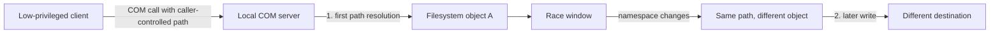
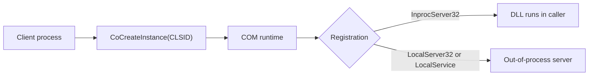
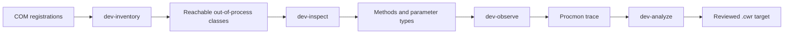
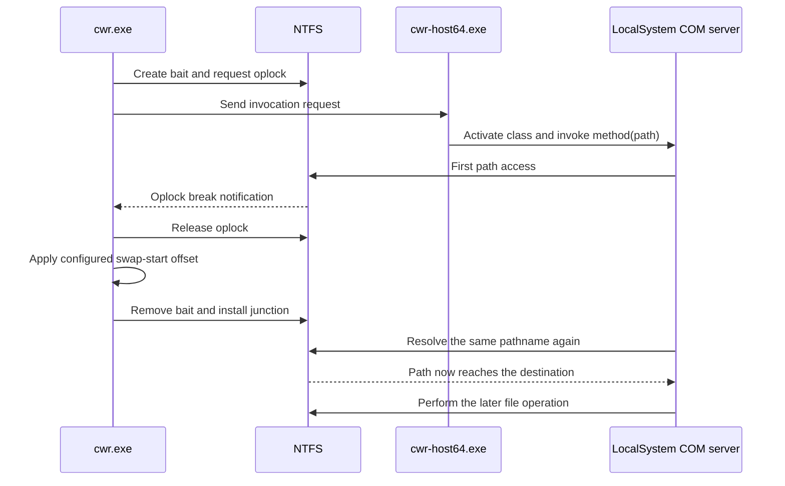

ComWriteRace started from a Windows file-handling pattern. A local COM server accepts a caller-controlled path, accesses it, then resolves the same path again for a later file operation. If the filesystem namespace changes between those resolutions, the later operation may reach a different object.

I tested the engine against an intentionally vulnerable COM fixture. I have not confirmed a vulnerable Microsoft or third-party COM server.

The candidate pattern is:

```text
reachable COM method
+ caller-controlled pathname
+ privileged filesystem operation
+ at least two name resolutions
+ a controllable interval between them
= candidate redirected write
```

The issue is not that COM is privileged or that junctions bypass ACLs. The question is whether a privileged operation uses a pathname again after the object behind that name has changed.



## The COM boundary

A client activates a class by its CLSID, then calls a method on an interface identified by an IID. `CoCreateInstance` asks COM to activate the class. The registration determines whether its implementation is an in-process DLL or an out-of-process server.



An in-process DLL runs inside the caller. An out-of-process object can service the call from a process with a different token. That process boundary makes its file operations worth examining, but it does not make the class an elevation vector by itself.

ComWriteRace focuses on local activation. DCOM uses COM over RPC between machines, but remote DCOM is outside this tool's scope.

## Finding candidates

I wanted target research to be part of the workflow. The tool has developer commands to inventory registrations, inspect callable methods, observe filesystem behavior, and turn reviewed findings into target data.



`dev-inventory` records server registration details and can actively probe whether the current token can activate an out-of-process class. Depending on configuration, it checks with both x64 and x86 hosts. A registry entry alone is weaker evidence than a successful activation from the token being tested. The inventory also records whether the object exposes `IDispatch`.

`dev-inspect` reads type information when a class exposes it. It enumerates methods and parameters, then ranks write-shaped names and path-like string parameters for review. This is triage, not vulnerability detection. A method such as `SaveFile(BSTR destination)` is a more useful lead than `GetVersion()`.

When a class has no type library, the tool reports that limitation. It does not claim to reconstruct an interface it cannot see.

For filesystem behavior, I invoke the method without racing it and capture Procmon. `dev-analyze` groups events by process, PID, and normalized path. It looks for repeated successful opens, probe-then-open sequences, close-and-reopen ordering, and later effects such as writes, deletes, moves, reads, or DLL loads. It also records the process identity and whether the path is under a root controlled for the experiment.

The analyzer returns a score with reasons rather than a `vulnerable: yes` result. The analyst still has to decide whether the observed sequence supports a race hypothesis.

## Target data

Reviewed target behavior lives in a `.cwr` module. The fixture definition describes the method and race mechanics as data:

```json
{
  "schema": "cwr.target.v1",
  "id": "com-fixture-race",
  "variants": [
    {
      "id": "local-server",
      "actions": {
        "write": {
          "invoker": "idispatch",
          "clsid": "{A67AA528-7B18-4B7A-92A4-18ED10263791}",
          "method": "RaceWrite",
          "vulnerability_pattern": "double_open_path_write",
          "privileged_operation": "file_write",
          "race_trigger": "oplock_on_source",
          "bait_precreated": true,
          "bait_kind": "file",
          "swap_primitive": "junction_redirect",
          "attacker_controlled_path_arg": 0
        }
      }
    }
  ]
}
```

The complete definition also describes operation policy, payload handling, typed method arguments, and retry safety. A target update should change the module when a product changes its CLSID, method, or arguments. It should not require a rewrite of the race engine.

For automation-friendly servers, the host uses `IDispatch`: it resolves the method with `GetIDsOfNames` and invokes it with typed arguments. A native adapter handles interfaces that cannot use the generic invoker. In both cases, the adapter owns invocation details; the engine owns synchronization and filesystem operations.

## Synchronizing the race

The native build produces `cwr.exe` and `cwr-host64.exe`. The engine sends an invocation request to the host, which activates the COM class and calls the method. This keeps a blocked or misbehaving COM call out of the engine thread while the engine waits on filesystem events. The IPC request is created with exclusive sharing, kept open, size-limited on return, and cleaned up with stale broker files.

The validated sensor is an oplock on the bait file. The engine creates the bait, arms the oplock, and starts the COM call. When the server opens the bait, NTFS fires the oplock break and holds the server's open until the engine releases it. That is what makes the timing deterministic instead of a guess: the break is a precise edge that marks the first access, and the hold gives the engine a known window to act before the server continues. A fixed sleep would have to assume how long the server takes to reach the file; the oplock break measures it.



The timing model is named `release_before_swap`. The engine releases the victim, waits for the configured offset, then removes the bait and installs a mount-point junction on the prepared `safe` directory. The pathname passed to COM stays the same. The `safe` component changes from an ordinary directory to a junction.

`active_swap()` retries bait deletion while the window is open. Once the bait is gone, it installs the prepared reparse point using the pinned directory handle. Short yields keep the loop responsive without adding a fixed millisecond sleep in the critical section.

The synchronization and redirection are separate controls: the oplock indicates when the first access occurred; the junction changes where the later path resolution leads. Neither control alone demonstrates a vulnerable target.

## `check` and `write`

`check` uses a destination inside the controlled workspace. If the later operation reaches that destination, it confirms that the fixture resolved the name again after the namespace changed. It does not prove that a real product is vulnerable or that the caller crossed a privilege boundary.

`write` tests a chosen destination. Before a boundary-write test, the runner checks whether the caller can create a file there directly. If the caller already has access, the tool can still prove exact placement, but it cannot claim a privilege boundary crossing.

The runner also rejects workspace and destination layouts that overlap, pins important directories, journals active sessions, and can recover a stale junction after an interrupted run. For file payloads, it stages the bytes and compares hashes. A successful result can therefore bind the destination file to the staged payload instead of treating any file's presence as proof.

The `exec` action is available only when a target module defines its DLL or script semantics. A write result is not reported as code execution.

## Evidence from the fixture

The first validation used an intentionally vulnerable out-of-process COM fixture. Its `RaceWrite` method accessed the supplied path, waited for a controlled interval, and then copied data through the same pathname. That fixture tested activation, brokered invocation, oplock signaling, the junction swap, later name resolution, exact-byte placement, and evidence generation. It was an integration test, not a privilege-escalation result.

I then fixed the engine's swap-start offset at 2000 us and varied the fixture's reopen gap across 72 trials on one VM. The win fractions below are from small per-cell samples in that single run, not a committed benchmark; the repository has no harness that regenerates them, so read them as the shape of one experiment rather than a measured constant.

| Fixture reopen gap | Win fraction |
|---:|---:|
| 0 to 1000 us | 0.000 |
| 1500 to 2500 us | 0.125 |
| 3000 us | 0.375 |
| 4000 us | 0.250 |
| 5000 us | 0.250 |

Every trial below roughly 1.5 ms lost in this run. Above that range the result became probabilistic. These values describe this fixture and VM only. When a single fixed offset misses, the engine can escalate the swap-start offset across attempts on a schedule that is unit-tested in `test_swap_timing.cpp` (base, then base plus 1 ms, 5 ms, 10 ms, 20 ms), which is the reproducible part of the timing behavior.

Before testing the COM transport, I tested the filesystem primitive with a victim process running under a separate privileged account. The low-privileged account could not write to the victim directory or the all-users Startup folder. With the race disabled, the payload stayed in the shared bait location. With the race enabled, the exact payload reached the protected destination. This established the filesystem behavior across account identities, but did not test COM activation.

### LocalSystem COM service

For the final fixture test, I registered the intentionally vulnerable COM server as a Windows service running as LocalSystem. A plain local user activated the class through `CoCreateInstance`; SCM and RPCSS routed the request to the service.

The lab registration needed the CLSID's `AppID` and `LocalService`, the corresponding `LocalService` value on the AppID, the executable's AppID association, and launch/access permissions for the test user. Missing registration values produced `REGDB_E_CLASSNOTREG`; insufficient permissions produced access denied during class-object connection.

On successful trials, the engine reported that the COM call returned. The fixture log recorded the exact line `victim_probe user=Système`, showing that the method ran as LocalSystem on the French Windows lab. The user account still drove the call.

The negative control used the same caller, engine, COM method, service, payload, and destination. I delayed the swap by 500 ms, well beyond the fixture's 3 ms reopen gap. The fixture copied to the ordinary bait path, and nothing appeared in the protected destination. Restoring the race timing changed the destination. This isolates the namespace swap as the variable in the fixture test.

The impact run targeted the all-users Startup directory:

```text
C:\ProgramData\Microsoft\Windows\Start Menu\Programs\StartUp\
```

The low-privileged account could not create files there directly. The single-attempt run used a 1000 us swap-start offset. The source, staged payload, and destination had the same SHA-256:

```text
A2A50AF7C6C674DB9703291CDF076F055BC30C10CEDFC44DA5F8DAD61BEE27B9
```

The destination file was owned by `BUILTIN\Administrateurs`. The fixture log independently recorded the service-side method running as `Système`. A later administrator logon ran the Startup item, and the marker reported `windows\vboxuser`. The writer and later executor were different identities.

The engine recorded these predicates:

```json
"predicates": {
  "input_control": "proven",
  "initial_touch": "observed",
  "later_name_resolution": "observed_sha256_bound_redirect",
  "caller_create_access": "denied",
  "boundary_write": "observed_effect_beyond_caller_access"
}
```

The engine's own attribution remained conservative:

```text
boundary_write.proven = true
causal_writer_attribution = unavailable_without_writer_telemetry
writer_identity.status = unknown
```

The hash-bound effect and denied caller access support a boundary-write result. The tool alone did not identify the creating process. The fixture log and file owner supplied separate evidence for the LocalSystem test.

The successful run also recorded the timing around the swap:

| Stage | Time |
|---|---:|
| COM invocation start to oplock trigger | 32.3976 ms |
| Trigger to oplock release | 0.0492 ms |
| Release to bait removed | 1.2171 ms |
| Bait removed to junction installed | 0.0342 ms |
| Junction installed to COM return | 18.9899 ms |
| Start to final target check | 54.2023 ms |
| Swap retries | 0 |

The critical interval was the 1.2171 ms between releasing the oplock and removing the bait. The full COM call took longer, but that duration is not the race window.

## Other implementation paths

The native engine has interfaces for directory-watch and WNF sensing, Cloud Files bait, Object Manager symbolic links, and DOS-device redirection. I have not validated all of these to the same level. The results above use `oplock_on_source` with `junction_redirect`.

`sharp/SharpCwr` contains a smaller C# 5 / .NET Framework 4.0 implementation. It supports `auto`, `targets`, `info`, `check`, and `write` for the common `IDispatch`, oplock, and mount-point-junction path. The native CLI remains the full implementation.

The core operator flow is:

```text
cwr scan
cwr targets
cwr info TARGET_ID
cwr check TARGET_ID
cwr write TARGET_ID --file payload.bin --dest <approved-destination>
```

The research commands cover inventory, method inspection, Procmon capture, and trace analysis:

```text
cwr dev-inventory ...
cwr dev-inspect --clsid "{...}" ...
cwr dev-observe ...
cwr dev-analyze --trace procmon.csv ...
```

## Limits of the result

The repository validation proves the engine and the path-re-resolution pattern against a controlled fixture. The LocalSystem test used genuine local COM activation through SCM/RPCSS, but the fixture method was written to be vulnerable.

I have not shown that a particular Microsoft or third-party COM server is vulnerable. A real target still needs to be reachable from the tested token, accept a caller-controlled path, perform a privileged filesystem operation, resolve the name again after the first access, and leave a raceable interval.

The measured win fractions are specific to the fixture and VM. The engine can establish a hash-bound write beyond the caller's access, but it cannot identify the causal writer without external telemetry. The fixture log and NTFS ownership supplied that separate evidence for this test.
