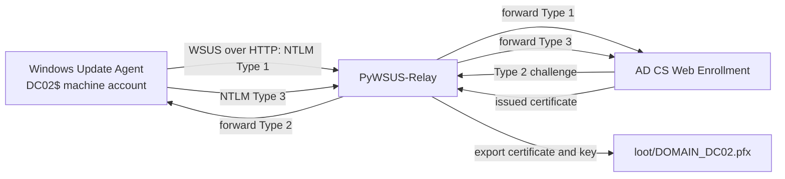
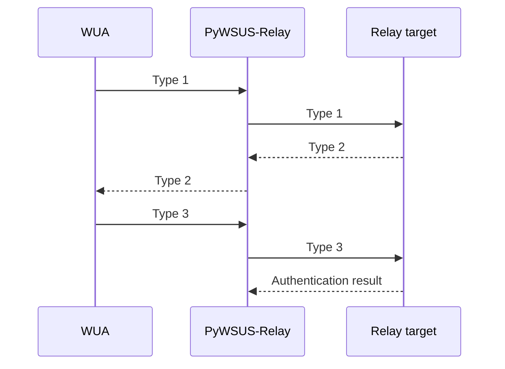
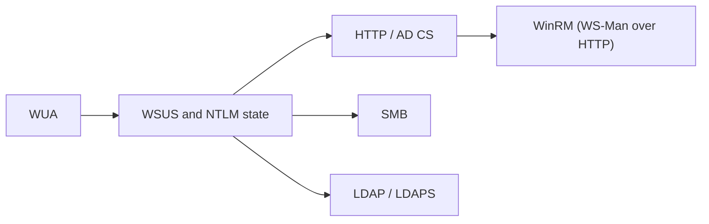
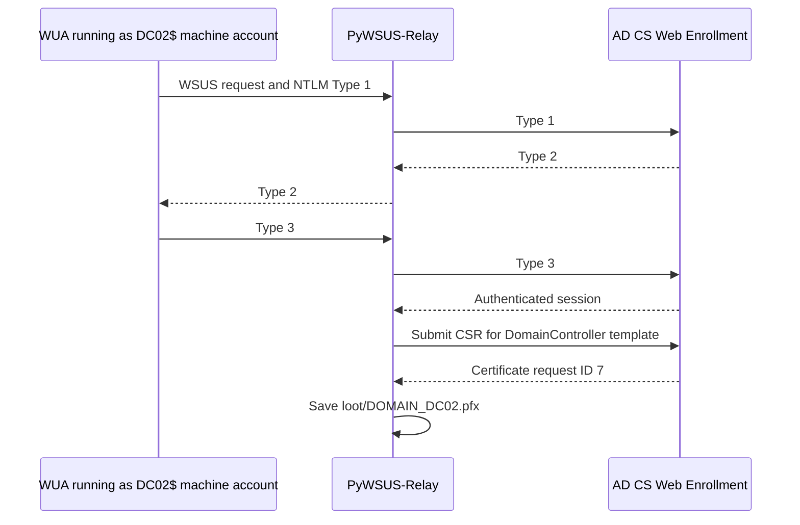

PyWSUS implements enough of the Windows Server Update Services protocol to act as a rogue update server. I extended it so the Windows Update Agent (WUA) authentication exchange can also be used as an NTLM relay source.

The strongest end-to-end result I reproduced was a WUA machine account authenticating to the rogue server, relaying to AD CS Web Enrollment, and enrolling a `DomainController` certificate. The issued certificate was saved as `loot/DOMAIN_DC02.pfx`.

This depends on a client using a WSUS endpoint that can be redirected to the server. It does not make arbitrary Windows clients authenticate to a listener. Microsoft documents TLS for WSUS metadata endpoints; clients also verify the signatures and hashes on update payloads. Those are separate parts of the update flow. [Microsoft WSUS TLS guidance](https://learn.microsoft.com/en-us/windows-server/administration/windows-server-update-services/deploy/2-configure-wsus) [GoSecure PyWSUS](https://github.com/GoSecure/pywsus)



## The WSUS conversation stays intact

WUA makes a sequence of SOAP requests. Depending on client state, that can include `GetConfig`, `GetCookie`, `RegisterComputer`, `SyncUpdates`, `GetExtendedUpdateInfo`, and `ReportEventBatch`.

PyWSUS-Relay keeps responding to those requests after the authentication exchange. The relay is an additional layer around the WSUS server, not a replacement for it.

The original PyWSUS update-delivery path is separate from the relay path. It can build update metadata around an existing Microsoft-signed executable. That does not sign a custom payload as Microsoft, and the relay validation described here did not depend on executing an update.

## Capture and relay use different challenges

NTLM over HTTP uses three messages:

```text
Type 1: Negotiate
Type 2: Challenge
Type 3: Authenticate
```

In capture mode, PyWSUS-Relay creates the Type 2 challenge and parses the Type 3 response. It can write NetNTLMv1 or NetNTLMv2 material to `netntlm-captures.txt` and emit structured events.

In relay mode, the target creates the Type 2 challenge. PyWSUS-Relay forwards that challenge to WUA, then forwards WUA's Type 3 response to the target.



The implementation has to keep three pieces of state aligned: the WSUS request, the NTLM handshake, and the outbound target connection. WUA may retry requests or open multiple connections. A single global challenge value would pair messages from different handshakes. PyWSUS-Relay therefore keeps short-lived session state and supports keys based on client IP or source connection with `--ntlm-session-key ip` and `--ntlm-session-key connection`.

## Relay backends and validation levels

The code separates inbound WSUS/NTLM handling from outbound protocol backends. There are modules for HTTP, SMB, and LDAP/LDAPS, plus AD CS Web Enrollment actions on the HTTP path. WinRM is not a separate backend module: it runs WS-Management over the same HTTP transport.



The available follow-up actions differ by backend. The HTTP path can check authentication. AD CS can validate Web Enrollment and submit a certificate request. SMB can list shares or keep a session open. LDAP actions are read-only checks such as RootDSE, WhoAmI, and base searches. WinRM can identify the authenticated session or attempt a command, but accepted NTLM authentication does not guarantee command execution.

The validation history is not the same for every backend. The AD CS flow below was reproduced end to end in my lab. I have not established the same result for each SMB, LDAP/LDAPS, or WinRM action, so I do not treat those implementations as equivalent validation.

## AD CS Web Enrollment

Relaying NTLM to AD CS Web Enrollment is the ESC8 technique. What is specific here is the source of the authentication: a Windows Update Agent machine account driven through a WSUS endpoint that can be redirected, rather than a coercion method such as PetitPotam or the printer bug.

The lab client authenticated as `DOMAIN\DC02$`. PyWSUS-Relay forwarded the NTLM exchange to AD CS Web Enrollment at `/certsrv/`.

The AD CS flow has two stages. `adcs-certsrv` checks whether the relayed session reaches the Web Enrollment application, including a probe to `/certsrv/certrqxt.asp`. `adcs-issue` then generates key material, builds a CSR, submits it, retrieves the issued certificate, and writes a PFX. Authentication success and certificate issuance are recorded separately, so a template or policy rejection does not look like a relay failure.

The successful lab result recorded:

```text
authenticated=True
validation=type3-and-followup
followup=accepted
service=adcs-web-enrollment
service_validated=True
adcs_issued=True
cert_id=7
pfx=loot/DOMAIN_DC02.pfx
```

That demonstrates this chain in the controlled lab:



An accepted Type 3 alone would only show that the target accepted the authentication. The follow-up check showed that the session reached Web Enrollment, and the issued certificate showed that the enrollment action completed.

## Reading the result

I keep the evidence levels separate:

| Result | What it establishes |
| --- | --- |
| WUA request received | The client reached the WSUS endpoint. |
| Type 3 captured | WUA completed NTLM with PyWSUS-Relay. |
| Target accepted Type 3 | The relay authentication succeeded. |
| Follow-up accepted | The authenticated session reached the target service. |
| Certificate issued | The requested AD CS action completed. |

For the lab run, the certificate contents matched the issued artifact. The result does not establish that every WSUS client or AD CS deployment is vulnerable. The client must use a WSUS endpoint that can be redirected, and the target must accept relayed NTLM and authorize enrollment through an applicable template.

## Other implementation details

`RegisterComputer` supplies client details such as OS build, architecture, and OS description. PyWSUS-Relay stores these in `data/known_clients.json`. It also writes JSONL events, text logs, capture files, and AD CS debug HTML when available. `--ntlm-protect-downloads` controls whether the update download path uses the configured NTLM behavior, separately from WSUS service endpoints.

The JSONL records and backend results help separate repeated WUA retries from new evidence. For example, the same machine can authenticate more than once during normal request handling. Repeated Type 3 messages do not by themselves mean there were multiple distinct impact events.

## Limits and mitigations

The client must use WSUS over HTTP in a way that lets an attacker redirect or intercept traffic to the configured endpoint. The tool does not change WSUS policy on a remote machine. Correctly configured TLS and certificate validation make endpoint impersonation harder. Microsoft also documents signature and hash verification for update content.

Relay impact depends on target-side protections and authorization. SMB signing, LDAP signing, LDAPS channel binding, and IIS Extended Protection can prevent relay in their respective paths. AD CS Web Enrollment accepting authentication does not by itself guarantee certificate issuance. WinRM authentication does not guarantee an authorized or usable command session.

The result I can claim from this work is specific: I reproduced the WUA-to-AD-CS enrollment chain in a controlled lab. I have not shown that a particular WSUS deployment or relay target is vulnerable.

## References

- [PyWSUS-Relay repository](https://github.com/abdelaaziz0/pyWSUS-relay)
- [GoSecure PyWSUS](https://github.com/GoSecure/pywsus)
- [GoSecure: WSUS Attacks Part 1](https://gosecure.ai/blog/2020/09/03/wsus-attacks-part-1-introducing-pywsus/)
- [GoSecure: WSUS attacks and NTLM relaying](https://gosecure.ai/blog/2021/11/22/gosecure-investigates-abusing-windows-server-update-services-wsus-to-enable-ntlm-relaying-attacks/)
- [Microsoft MS-WUSP protocol specification](https://learn.microsoft.com/en-us/openspecs/windows_protocols/ms-wusp/)
- [Microsoft: Configure WSUS to use TLS](https://learn.microsoft.com/en-us/windows-server/administration/windows-server-update-services/deploy/2-configure-wsus)
- [Microsoft Defender for Identity: AD CS security posture](https://learn.microsoft.com/en-us/defender-for-identity/security-posture-assessments/certificates)
